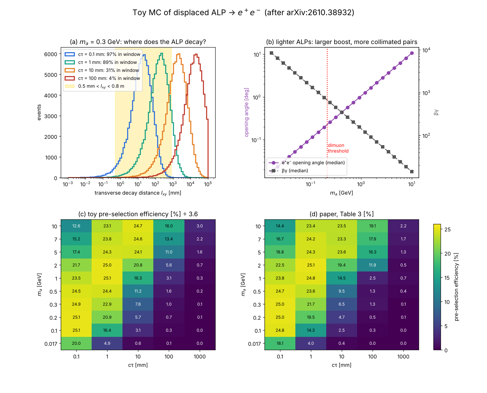
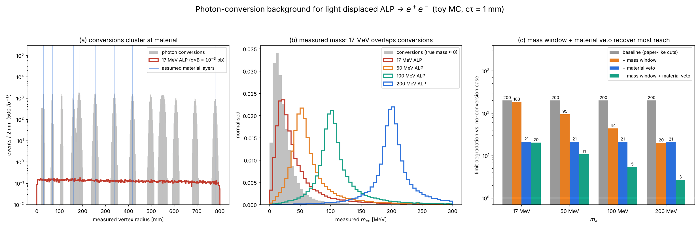
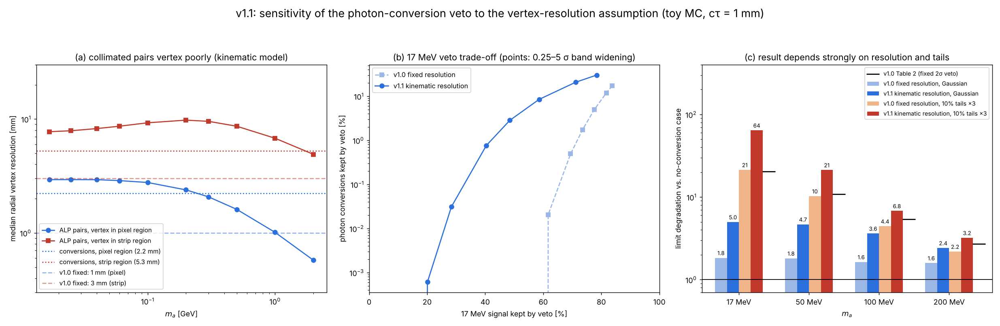

# ALP-ttbar Toy MC v1.1: Magnetic-Field Separation, Photon-Conversion Backgrounds and Vertex Resolution for Displaced Light ALP → e⁺e⁻ (companion to arXiv:2610.38932)

[](https://doi.org/10.5281/zenodo.23833475)

A small, numpy-only toy Monte Carlo written after reading

> J. Alimena, F. Blekman, C. Cazzaniga, X. Cid Vidal, J. Niedziela, L. Rygaard, R. Soto Rey,
> *Hunting for Long-Lived ALPs in Top Events via Displaced Dielectron Pairs at the LHC*,
> [arXiv:2610.38932](https://arxiv.org/abs/2610.38932)

It explores effects that the paper explicitly leaves outside its generator-level scope:

1. **Magnetic-field separation** of highly collimated e⁺e⁻ pairs (the paper uses straight lines).
2. **Photon conversions** (γ → e⁺e⁻ in tracker material) as a background for the lightest ALPs.
3. **Vertex resolution** of nearly collinear pairs and how strongly the conversion veto depends on it *(new in v1.1)*.

> **Disclaimer.** This is a personal project. It is not affiliated with the paper's authors or with the CMS
> Collaboration. ALP and photon kinematics are parametrised and detector numbers are assumed, so only
> qualitative trends and ratios are meaningful. See the PDF for all assumptions and limitations.

## Key results (toy, cτ = 1 mm, barrel |η| < 1.2)

| m_a | pairs resolved, straight lines | pairs resolved, 3.8 T field | limit degradation from conversions (v1.0 settings) |
|---|---|---|---|
| 17 MeV | 55% | 97% | ~20× |
| 50 MeV | 87% | 97% | ~11× |
| 100 MeV | 95% | 97% | ~5× |
| 200 MeV | 99% | 98% | ~3× |

"Resolved" means the two hits are separated by more than an assumed two-hit resolution in ≥ 3 barrel layers
(a geometric criterion, not a tracking efficiency). Without extra cuts, conversions degrade the expected reach by
~200× in this toy. The last column uses the v1.0 assumptions (fixed vertex resolution, 2σ veto band, mass window);
v1.1 shows that this number is **not robust** for the lightest masses.

## New in v1.1: how robust is the conversion veto?

v1.0 assumed a fixed radial vertex resolution (1 mm pixel / 3 mm strip). v1.1 (`vtx.py`) estimates a per-pair
resolution from the pair opening angle and the opposite bending in 3.8 T, optimises the veto width, and tests
non-Gaussian tails (10% of pairs with 3× larger errors). Limit degradation from conversions (cτ = 1 mm):

| m_a | v1.0 (2σ band) | fixed, Gaussian | per-pair, Gaussian | fixed, tails | per-pair, tails |
|---|---|---|---|---|---|
| 17 MeV | 20× | 1.8× | 5.0× | 21× | 64× |
| 50 MeV | 11× | 1.8× | 4.7× | 10× | 21× |
| 100 MeV | 5.4× | 1.6× | 3.6× | 4.4× | 6.8× |
| 200 MeV | 2.7× | 1.6× | 2.4× | 2.2× | 3.2× |

- Pairs below a few hundred MeV vertex about as poorly as conversions: ≈ 3 mm (pixel region) and ≈ 8–10 mm (strip region).
- The outcome at 17 MeV is set mostly by resolution **tails**, ranging from ≈ 2× to ≈ 60× loss in reach.
- At 100–200 MeV the conclusion is stable (≈ 1.5–7× in all scenarios).

## Figures

**Figure 1.** Decay geometry, boost and opening angle, and toy pre-selection efficiency compared with Table 3 of the paper (after one global normalisation factor).



**Figure 2.** Hit separation of e⁺e⁻ pairs in the CMS barrel layers with straight lines vs. a 3.8 T field, and the resulting fraction of resolvable pairs.


**Figure 3.** Photon conversions: measured vertex radius, measured mass, and degradation of the expected limit for successive selections (v1.0 settings).



**Figure 4 (new in v1.1).** Per-pair vertex resolution vs. mass, the 17 MeV veto trade-off, and the limit degradation for four resolution scenarios.



## Files

| file | content |
|---|---|
| `alp_toy.py` | ALP kinematics, decay geometry, pre-selection efficiency vs. paper Table 3 |
| `mag.py` | helix propagation in a 3.8 T solenoid through CMS Phase-1 barrel layers |
| `bkg.py` | photon-conversion background, smearing, mass window, material veto, crude limits (v1.0 behaviour by default) |
| `vtx.py` | *(v1.1)* per-pair radial vertex resolution |
| `plot_efficiency.py`, `plot_bfield.py`, `plot_conversions.py`, `plot_vertex.py` | produce Figures 1–4 and print the numbers |
| `run_all.sh` | reproduces everything (about 1 minute) |
| `fig1_…png` … `fig4_…png` | result figures |
| `ALP_ttbar_Displaced_Dielectron_Toy_MC_Summary_v1.1_2026-10-31.pdf` | 4-page write-up |
| `ALP_ttbar_Displaced_Dielectron_Toy_MC_arXiv2610.38932_v1.1_2026-10-31.zip` | complete snapshot with the original folder layout (`figures/`, `docs/`) |

## Reproduce

```bash
pip install -r requirements.txt
./run_all.sh
```

Fixed random seeds are used, so the numbers above are reproduced exactly. Re-running writes the figures and
printed numbers into a `figures/` folder.

## Known limitations

Parametrised kinematics; barrel only; no FSR, pile-up, track-finding efficiency, calorimeter or isolation
modelling; assumed material map and resolutions; tt̄γ rate is an order-of-magnitude assumption; other
backgrounds in the paper are not included; the v1.1 vertex-resolution model is an error-propagation estimate
(no real vertex fit, no hit-pattern information), the tail scenario is illustrative and the veto width is
optimised on the same samples; the toy's absolute pre-selection efficiency is ~3.6× higher than the paper's
(the shape agrees), which is not understood.

## Citation

If you use this code, please cite:

> Paik, W. S. (2026). *ALP-ttbar Toy MC v1.1: Magnetic-Field Separation, Photon-Conversion Backgrounds and Vertex
> Resolution for Displaced Light ALP → e+e− (companion to arXiv:2610.38932)* (v1.1) [Preprint]. Zenodo.
> https://doi.org/10.5281/zenodo.23833475

Previous version (v1.0, Figures 1–3 only): https://doi.org/10.5281/zenodo.23825276

## Version history

- **v1.1** (2026-10-31): per-pair vertex resolution, veto-width optimisation and tail test (Figure 4); 50 MeV added to Figure 2; minor clean-ups. v1.0 numbers are reproduced unchanged.
- **v1.0** (2026-10-31): Figures 1–3.

## License

MIT, see `LICENSE`.
