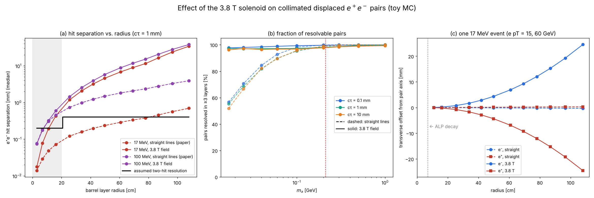

# Toy MC: displaced light ALP → e⁺e⁻ in tt̄ events (companion to arXiv:2610.38932)

A small, numpy-only toy Monte Carlo written after reading

> J. Alimena, F. Blekman, C. Cazzaniga, X. Cid Vidal, J. Niedziela, L. Rygaard, R. Soto Rey,
> *Hunting for Long-Lived ALPs in Top Events via Displaced Dielectron Pairs at the LHC*,
> [arXiv:2610.38932](https://arxiv.org/abs/2610.38932)

It explores two effects that the paper explicitly leaves outside its generator-level scope:

1. **Magnetic-field separation** of highly collimated e⁺e⁻ pairs (the paper uses straight lines).
2. **Photon conversions** (γ → e⁺e⁻ in tracker material) as a background for the lightest ALPs.

> **Disclaimer.** This is a personal project. It is not affiliated with the paper's authors or with the CMS
> Collaboration. ALP and photon kinematics are parametrised and detector numbers are assumed, so only
> qualitative trends and ratios are meaningful. See the PDF for all assumptions and limitations.

## Key results (toy, cτ = 1 mm, barrel |η| < 1.2)

| m_a | pairs resolved, straight lines | pairs resolved, 3.8 T field | limit degradation from conversions (mass window + material veto) |
|---|---|---|---|
| 17 MeV | 55% | 97% | ~20× |
| 50 MeV | — | 97% | ~11× |
| 100 MeV | 95% | 97% | ~5× |
| 200 MeV | 99% | 98% | ~3× |

Without the extra cuts, conversions degrade the expected reach by ~200× in this toy.

## Figures

**Figure 1.** Decay geometry, boost and opening angle, and toy pre-selection efficiency compared with Table 3 of the paper (after one global normalisation factor).


**Figure 2.** Hit separation of e⁺e⁻ pairs in the CMS barrel layers with straight lines vs. a 3.8 T field, and the resulting fraction of resolvable pairs.



**Figure 3.** Photon conversions: measured vertex radius, measured mass, and degradation of the expected limit for successive selections.


## Files

| file | content |
|---|---|
| `alp_toy.py` | ALP kinematics, decay geometry, pre-selection efficiency vs. paper Table 3 |
| `mag.py` | helix propagation in a 3.8 T solenoid through CMS Phase-1 barrel layers |
| `bkg.py` | photon-conversion background, smearing, mass window, material veto, crude limits |
| `plot_efficiency.py`, `plot_bfield.py`, `plot_conversions.py` | produce Figures 1–3 and print the numbers |
| `run_all.sh` | reproduces everything (~30 s) |
| `fig1_…png`, `fig2_…png`, `fig3_…png` | result figures |
| `ALP_ttbar_Displaced_Dielectron_Toy_MC_Summary_v1.0_2026-10-31.pdf` | 4-page write-up |
| `ALP_ttbar_Displaced_Dielectron_Toy_MC_arXiv2610.38932_v1.0_2026-10-31.zip` | complete snapshot with the original folder layout (`figures/`, `docs/`) |

## Reproduce

```bash
pip install -r requirements.txt
./run_all.sh
```

Fixed random seeds are used, so the numbers above are reproduced exactly. Re-running writes the figures and printed numbers into a new `figures/` folder.

## Known limitations

Parametrised kinematics; barrel only; no FSR, pile-up, track-finding efficiency, calorimeter or isolation
modelling; assumed material map and resolutions; tt̄γ rate is an order-of-magnitude assumption; other
backgrounds in the paper are not included; the toy's absolute pre-selection efficiency is ~3.6× higher than
the paper's (the shape agrees), which is not understood.

## License

MIT, see `LICENSE`.
